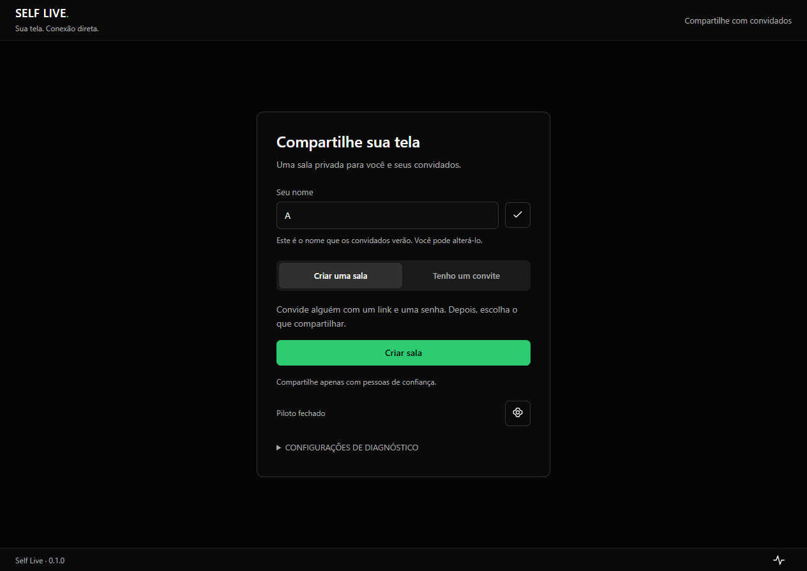
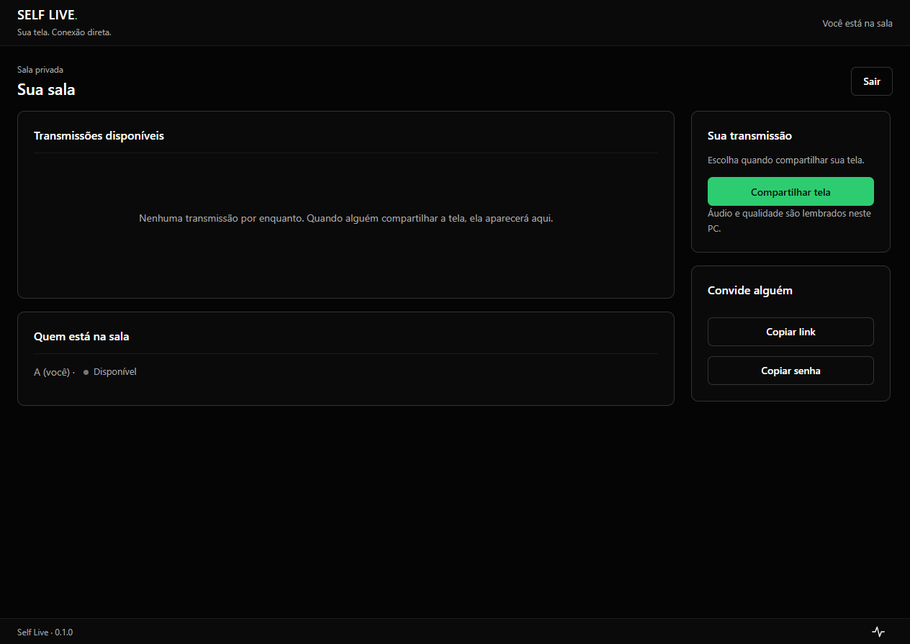
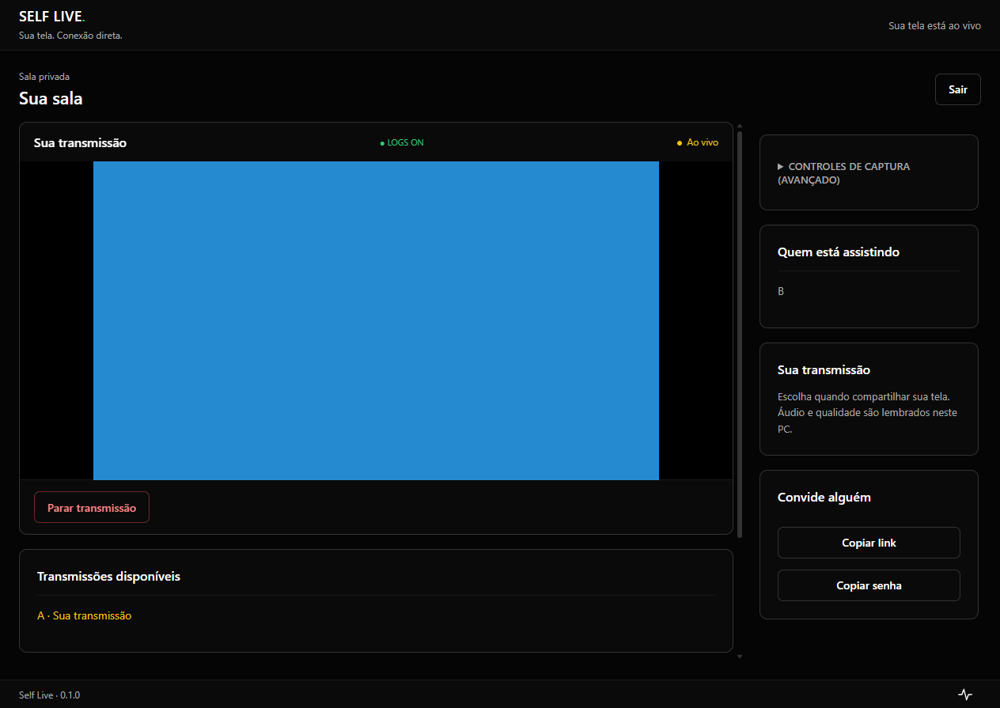
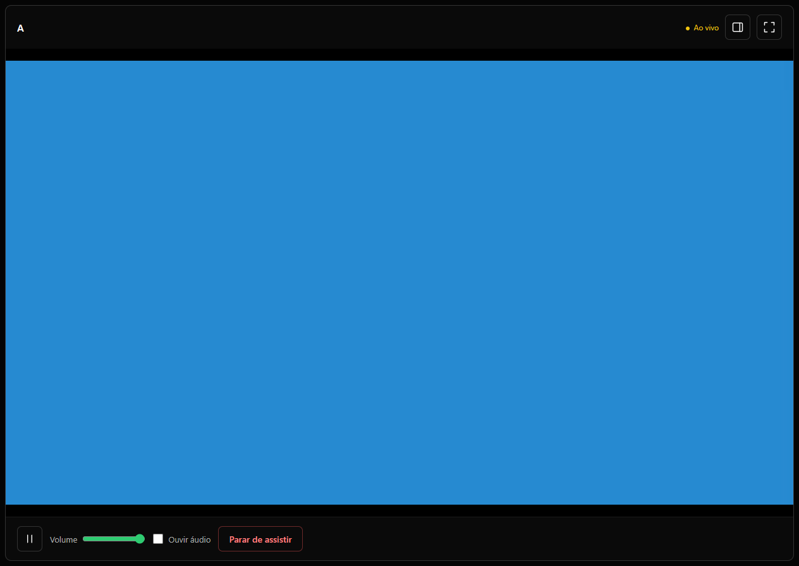

# Self Live · 0.1.0

MVP Electron para Windows 10/11. Implementa bandeja, dashboard em localhost,
handshake WSS privado, captura de tela + áudio de aplicativo, WebRTC loopback e
transmissão P2P real, presença em tempo real, múltiplos viewers por streamer e
troca de stream, encerramento limpo, detecção IPv6-first, mapeamento automático
PCP/NAT-PMP/UPnP e fallback TURN opcional, com relay de SDP/ICE via WSS,
links de acesso e indicadores de modo/RTT no dashboard.
Inclui signaling relay opcional na VPS, com fallback automático e SDP/ICE cifrados.
O código contém comentários nos pontos de segurança, captura e mídia.

## Dashboard

Na primeira abertura, preencha **Seu nome** na tela inicial: criar e entrar em sala
ficam bloqueados enquanto ele estiver vazio. O nome é salvo neste PC ao clicar em
**Salvar**, **Criar sala** ou **Entrar**, e aparece preenchido nas próximas aberturas.
Você pode editá-lo antes de entrar; ele será o nome exibido aos convidados, sem
precisar reiniciar. Perfis antigos com nome personalizado mantêm sua preferência.

A interface separa entrada, sala, transmissão e player. Na entrada, escolha
**Criar uma sala** ou **Tenho um convite**, com um fluxo por vez. Textos em caixa
normal, controles simples e ícones com descrição mantêm as ações principais claras.

Na sala, **Compartilhar tela** abre um único modal com prévias selecionáveis.
Escolha a tela/janela e clique em **Compartilhar**. Resolução e fps usam
suas preferências; áudio, bitrate e exclusões ficam em **Mais opções**.
A captura só começa na confirmação, e cancelar não altera as preferências.
Aplicativos de áudio usam caixas de seleção, sem precisar de Ctrl+clique.
O padrão é **Com áudio**: uma janela envia o som de seu aplicativo, inclusive
Discord quando sua janela for escolhida. Tela inteira envia os aplicativos de
áudio disponíveis, com Discord excluído por padrão. Em **Mais opções**, escolha
**Sem áudio** ou marque/desmarque aplicativos em **Não compartilhar som destes
aplicativos**. Essas exclusões só valem para tela inteira; outras chamadas precisam
ser excluídas por você. A regra Discord inclui Canary, PTB e Development.
O filtro opera por aplicativo, não por janela/aba: outras janelas e chamadas do
mesmo aplicativo também podem ser ouvidas. O microfone não é compartilhado.
**Copiar link** gera e copia o convite; **Copiar senha** copia a senha diretamente,
sem exibi-la ou abrir outro modal. O card confirma cada cópia. Envie-os separadamente.

A seleção de tela/janela mostra uma prévia local estática, renovada por **Atualizar**.
A etapa Qualidade oferece 144p, 240p, 360p, 480p, 720p, 900p e 1080p, além de
**Máxima da fonte**. Telas menores exibem apenas opções compatíveis; a captura
mantém as proporções e fica limitada a 1920 × 1080, sem ampliar janelas menores.
Você também escolhe **15, 30 ou 60 fps**. Resolução e fps ficam salvos junto às
demais preferências. A taxa efetiva pode cair conforme a fonte, o PC e a rede.

Após iniciar com sucesso, o app salva o modo de áudio, os aplicativos, as exclusões
manuais e a qualidade em `share-preferences.json`, no diretório de dados deste usuário
Windows. As preferências sobrevivem ao reinício. A tela/janela sempre exige uma nova
seleção; senhas e identificadores de janela não entram nesse arquivo. Sinalização,
relay, mídia e RTT continuam independentes. Criar sala usa a senha configurada no app.

| Entrada | Sala |
| --- | --- |
|  |  |
| Transmitindo | Assistindo |
|  |  |

Screenshots obtidos com captura sintética em duas instâncias Electron.
`npm run test:ui` valida as oito verificações visuais, os controles do player
e o modal, incluindo cancelamento, seleção de prévias, validação e ícones acessíveis,
sem acessar a VPS ou capturar a tela real. Também gera screenshots do modal em
`docs/screenshots/share-*.png` e da entrada por convite em `landing-join.png`.

## Executar

Para o primeiro **piloto fechado P2P**, use [o guia do executável portátil](docs/pilot.md).
`npm run dist:pilot` gera o EXE; configurações são salvas pelo app e a senha local
é protegida pelo armazenamento seguro do Windows. Este piloto usa mídia P2P;
a emissão de credenciais TURN pela VPS permanece pendente.

Instale Node.js 22 LTS ou superior e execute:

```powershell
npm install
npm run check
npm test
npm start
```

O dashboard abre dentro do Electron. Fechar a janela mantém a captura na bandeja;
use **Sair** para encerrar. Por padrão, o WSS escuta em `::` e `0.0.0.0` na mesma
porta, enquanto o dashboard HTTP permanece em 127.0.0.1. Cada processo usa sua
própria sessão Electron em memória. Portas livres são escolhidas quando não
configuradas; `SELF_LIVE_WS_HOST` ainda permite restringir o bind explicitamente.
No piloto, o mapeamento de portas começa desativado e pode ser habilitado em
**Configurar este PC**. Variáveis de ambiente explícitas continuam prevalecendo;
para manter testes locais sem mapeamento, use `$env:SELF_LIVE_UPNP = 'off'`.
Para desativar o signaling relay nos testes locais, use `$env:SELF_LIVE_RELAY_URL = ''`.

## Sinalização via relay

O host mantém o WSS local e registra a sala no relay em paralelo. O convite
`self-live://join?data=...` adiciona o relay com prioridade 3: IPv6 e IPv4 direto
continuam preferidos; cada endpoint tem timeout de 5 segundos, incluindo handshake.
Sala/senha rejeitada interrompe as tentativas. O relay offline não impede uso do WSS local.

O relay público já está disponível em **`wss://relay.murilod.dev:8443`**, com
certificado Let's Encrypt e renovação DNS-01 via Cloudflare na VPS. Não é preciso
configurar fingerprint: o cliente valida a cadeia pública e o hostname por TLS.
O WSS local mantém seu pin próprio, independente do relay.

Configure o host antes de iniciar:

```powershell
$env:SELF_LIVE_RELAY_URL = 'wss://relay.murilod.dev:8443'
# Opcional: namespace da sala no relay
$env:SELF_LIVE_RELAY_ROOM = 'minha-sala'
npm start
```

URL ausente usa esse domínio; URL vazia desativa. Gere um novo convite: o endpoint
do relay público não contém pin; viewers informam a senha separadamente. Para
relays privados self-signed, o pin opcional continua disponível. O hash de autenticação
continua `SHA-256(senha + sala)`; sala e SDP/ICE são protegidos no transporte externo
por token de sala e AES-256-GCM com chave derivada da senha por scrypt, distinta do hash.
O relay observa metadados de conexão, mas não recebe senha, sala em texto puro,
SDP/ICE decifrados ou mídia. Use senhas longas e aleatórias.

O dashboard separa **Sinalização** (direta ou via relay) de **Mídia** (IPv6/P2P ou
TURN). Backoff: 1, 2, 4, 8, 16 e 30 segundos. Quedas breves preservam mídia já
negociada; peers do transporte ficam retidos por até 90 segundos. Shutdown envia
goodbye e fecha o relay antes do WSS local, dentro do prazo existente.

```powershell
npm run test:relay
npm run test:fallback
npm run test:relay:public
```

`test:relay` e `test:fallback` usam relay TLS local efêmero e processos Electron
com H.264/Opus, verificando dashboard, recuperação da sinalização e continuidade
da mídia P2P. `test:relay` também verifica descoberta do host ao forçar a URL.
`test:relay:public` usa o domínio real, sem pin, em salas aleatórias de teste;
valida convite e URL forçada sem reiniciar o serviço da VPS.

Para validar manualmente com duas instâncias, mantenha a mesma sala/senha e nomes
distintos em dois terminais. No host, entre na sala e gere o link; no viewer,
cole o convite e entre. A sinalização direta será preferida e o cabeçalho mostrará
relay online como fallback. Para forçar o relay no viewer, sem convite:

```powershell
$env:SELF_LIVE_RELAY_URL = 'wss://relay.murilod.dev:8443'
$env:SELF_LIVE_SIGNAL_URL = 'wss://relay.murilod.dev:8443'
$env:SELF_LIVE_ROOM = 'minha-sala' # igual ao host
$env:SELF_LIVE_PASSWORD = 'mesma-senha-do-host'
$env:SELF_LIVE_NAME = 'Viewer'
npm start
```

Entre usando a senha da sala e clique em Assistir após o host iniciar a
transmissão. O dashboard mostra **🟡 Via relay**; a mídia indica P2P ou TURN
independentemente. Não configure `SELF_LIVE_SIGNAL_FINGERPRINT` para essa URL.
URL forçada descobre um host registrado no namespace; se houver vários hosts
independentes com a mesma sala/senha, use o convite para escolher o host exato.
`window.selfLive.relay` expõe `status`, `url`, `reconnects` e `backoff`;
`window.selfLive.signaling` informa `direct`, `relay` ou `failed`.
Veja [o guia completo](docs/relay-setup.md) para TLS, monitoramento, rotação e desinstalação.

## Validar captura primeiro

1. Toque áudio em um jogo ou outro aplicativo do Windows.
2. Selecione uma tela ou janela e clique em **Iniciar captura**.
3. Confira resolução/fps reais na prévia. Uma janela usa somente o áudio do seu
   aplicativo; para tela inteira, use **Mais opções → Com áudio** e marque os apps
   cujo som deve ficar fora (Discord já vem marcado), ou escolha **Sem áudio**. As exclusões
   e as fontes em uso aparecem no painel. A prévia fica muda para evitar realimentação.
4. Clique em **Iniciar Teste de Mídia Local**. Esse botão também pode iniciar a
   captura diretamente, sem precisar clicar em **Iniciar captura** antes.
   Dois endpoints locais negociam H.264 e
   Opus; SDP/ICE são trocados em memória. Use fones e marque **Ouvir áudio**.
5. Confira codecs H.264/Opus, fps e encoder informado pelo Chromium no viewer. **Parar Teste**
   encerra ambos os endpoints e todas as tracks.

O teste local é dentro de uma instância. Para mídia entre instâncias, use a
seção **Conexão P2P** e o procedimento abaixo.

## Validar handshake

Entre na sala com `self-live-local`. Outra senha deve ser rejeitada. Para alterar
as credenciais de desenvolvimento antes de iniciar:

```powershell
$env:SELF_LIVE_ROOM = 'minha-sala'
$env:SELF_LIVE_PASSWORD = 'minha-senha'
npm start
```

O certificado WSS é efêmero e self-signed. A sessão Electron aceita o certificado
da própria instância e o certificado do host configurado por impressão SHA-256;
não desativa validação TLS globalmente. Hash segue SHA-256(senha + sala).

## Testar dois peers na mesma máquina

As duas instâncias devem conectar ao **mesmo WSS**, o do Peer A. Ter portas
diferentes sem definir esse endereço criaria duas salas independentes.
Não há servidor de mídia: a instância A apenas encaminha sinalização da sala.

No terminal A:

```powershell
$env:SELF_LIVE_HTTP_PORT = '3000'
$env:SELF_LIVE_WS_PORT = '4000'
$env:SELF_LIVE_NAME = 'Peer A'
Remove-Item Env:SELF_LIVE_SIGNAL_URL -ErrorAction SilentlyContinue
Remove-Item Env:SELF_LIVE_SIGNAL_FINGERPRINT -ErrorAction SilentlyContinue
npm start
```

Copie o SHA-256 mostrado no terminal A ou na seção **Conexão P2P** do dashboard.
No terminal B, substitua a impressão de exemplo pela impressão completa copiada:

```powershell
$env:SELF_LIVE_HTTP_PORT = '3001'
$env:SELF_LIVE_WS_PORT = '4001'
$env:SELF_LIVE_NAME = 'Peer B'
$env:SELF_LIVE_SIGNAL_URL = 'wss://127.0.0.1:4000'
$env:SELF_LIVE_SIGNAL_FINGERPRINT = 'COLE_A_IMPRESSAO_SHA256_DO_PEER_A'
npm start
```

1. Entre na sala em ambos os dashboards usando `self-live-local` (ou a mesma
   sala/senha configurada nos dois terminais).
2. No Peer A, selecione uma tela/janela e clique em **Iniciar Transmissão**.
3. No Peer B, clique em **Assistir** ao lado de Peer A. O vídeo aparece em
   **Conexão P2P**, com status **Assistindo Peer A**.
4. Use fones e marque **Ouvir áudio P2P** no viewer. O vídeo começa mudo para
   evitar realimentação; o áudio é transmitido mesmo quando o player está mudo.
5. **Parar de Assistir** fecha a conexão do viewer. **Parar Transmissão** encerra
   os envios e a captura do streamer. O alvo rejeita pedidos se não estiver
   transmitindo; o viewer não consegue iniciar captura no outro peer.

O certificado muda ao reiniciar o host; copie a nova impressão e reinicie B.
O relay valida `from` contra o socket autenticado e encaminha `offer`, `answer`,
`ice`, `watch_request`, `stop_watching` e `watch_rejected` para `to`, sem analisar SDP/ICE.
`session_id` identifica cada tentativa e descarta candidatos de conexões antigas.
Candidatos recebidos antes da remote description aguardam em uma fila.

## Testar sala com três instâncias (Fase 4)

Use os terminais A/B configurados acima e abra um terceiro terminal para C:

```powershell
$env:SELF_LIVE_HTTP_PORT = '3002'
$env:SELF_LIVE_WS_PORT = '4002'
$env:SELF_LIVE_NAME = 'Peer C'
$env:SELF_LIVE_SIGNAL_URL = 'wss://127.0.0.1:4000'
$env:SELF_LIVE_SIGNAL_FINGERPRINT = 'COLE_A_MESMA_IMPRESSAO_SHA256_DO_PEER_A'
npm start
```

Todos usam a mesma sala e senha. A mantém o relay, mas B também pode transmitir.

1. Entre na sala nas três instâncias. Confira os três nomes em **Usuários**.
2. No B, clique em **Iniciar Transmissão**. A/C devem mostrar B como
   **Transmitindo**, com botão **Assistir**, e seus metadados em **Streams disponíveis**.
3. No A e no C, assista B. São dois viewers simultâneos da mesma captura de B,
   cada um com sua própria `RTCPeerConnection`. Parar um viewer preserva o outro.
4. Inicie uma transmissão no A e, no C, clique em **Assistir** no A. O C envia
   `stop_watching` ao B, encerra a conexão antiga e passa a mostrar **Assistindo Peer A**.
5. Pare a transmissão do B. C continua assistindo A. Se A ainda estava assistindo
   B, A mostra **Streamer parou de transmitir** e encerra apenas seu receiver.
6. Reinicie B, faça C assistir B e pare B novamente. C deve mostrar
   **Streamer parou de transmitir**, limpar o vídeo e remover B dos streams disponíveis.
7. Reinicie B e assista com A/C. Encerre o aplicativo C pelo menu **Sair** da
   bandeja. A/B removem C da presença; B fecha só a conexão de C e continua enviando a A.

Fechar somente a janela esconde o dashboard na bandeja e mantém o peer na sala.
Use **Sair** para encerrar o processo, ou **Sair** no formulário da sala para
fechar o WebSocket mantendo o aplicativo aberto.

`user_joined` é enviado aos outros peers; `welcome` já inclui o próprio usuário,
os demais peers e os streams ativos para quem entra depois. `user_left` limpa a
presença. O streamer anuncia `stream_started`/`stream_stopped`; a sala autentica
`node_id`, guarda `stream_id` e metadados e faz broadcast a todos. Sair da sala
também remove o stream ativo. Um stop atrasado não remove uma transmissão nova.

## Testar na LAN

O Peer A já escuta em IPv6 e IPv4 por padrão. Para remover uma restrição antiga,
execute `Remove-Item Env:SELF_LIVE_WS_HOST -ErrorAction SilentlyContinue` antes de iniciar.
No Peer B, use um endpoint detectado no dashboard de A, por exemplo
`wss://IP_LAN_DO_PEER_A:4000`, e a impressão SHA-256 do Peer A.
O dashboard continua restrito a localhost. Permita o Electron/WSS na rede privada
no Firewall do Windows, incluindo a porta TCP configurada e a faixa WebRTC UDP
mostrada no dashboard.
STUN público: `stun:stun.l.google.com:19302`. TURN é opcional, conforme a seção
abaixo. Mapeamento no roteador não substitui uma regra no firewall do computador.

## Conectividade automática (UPnP/NAT-PMP)

Depois de iniciar os servidores, o main tenta **PCP → NAT-PMP → UPnP** em segundo
plano. Mapeia a porta TCP do WSS e uma faixa de **16 portas UDP** da mídia,
preservando o número de cada porta externa/interna. O HTTP permanece em localhost
e não é mapeado. A captura e a sala podem funcionar enquanto essa descoberta ocorre.

O Chromium usa `setWebRTCUDPPortRange` antes de criar conexões. Mapear uma única
porta UDP não atenderia múltiplos viewers/loopback: os endpoints WebRTC precisam
de sockets distintos. A faixa é escolhida livre por instância; para port forwarding
manual estável, configure a primeira porta e a porta WSS antes de iniciar:

```powershell
$env:SELF_LIVE_WS_PORT = '4000'
$env:SELF_LIVE_MEDIA_PORT = '50000' # faixa UDP 50000–50015
$env:SELF_LIVE_UPNP = 'on'         # padrão
$env:SELF_LIVE_UPNP_TTL = '7200'   # padrão, 1200–86400 segundos
npm start
```

Instâncias simultâneas com porta de mídia explícita precisam de faixas diferentes.
Em `on`, falhas geram aviso e o app continua; `auto` tenta os mesmos protocolos,
mas silencia falhas de mapeamento. Para desabilitar completamente a descoberta
WAN/mapeamento no roteador:

```powershell
$env:SELF_LIVE_UPNP = 'off'
npm start
```

A consulta informativa ipify continua disponível; sem WAN do roteador, IPv4
atrás de NAT pode ficar **Desconhecido**. Bind WSS restrito a loopback também
desabilita o mapeamento. Os leases duram duas horas por padrão e são renovados
dez minutos antes de expirar; leases menores concedidos pelo roteador ajustam
o intervalo. Falha parcial desfaz a tentativa antes de testar outro protocolo.
Uma falha de renovação remove o anúncio de mapeamento do dashboard e atualiza
o link gerado. Copie a versão atualizada antes de compartilhá-la.

Em **Conexão P2P → Conectividade**, confira o método, a porta TCP, a faixa UDP e
o estado da rede. **Como resolver** abre instruções para firewall, UPnP,
port forwarding e IPv6. `window.selfLive.portMapping` fornece o snapshot atual
`{ tcp, udp, method, status }`, atualizado por IPC, sem expor o IP WAN.

`@achingbrain/nat-port-mapper` 4.0.5 fornece NAT-PMP e UPnP **IGD v2**. Como essa
versão não implementa PCP, o projeto inclui um adapter PCP MAP conforme o
[RFC 6887](https://www.rfc-editor.org/rfc/rfc6887). Roteadores somente IGD v1,
UPnP desativado, portas em conflito ou bloqueios da operadora podem exigir IPv6
ou configuração manual. Mapeamento bem-sucedido não prova alcance pela Internet;
CGNAT/NAT duplo continuam exigindo uma rota para o WSS.

## Entendendo seu estado de rede

A consulta IPv4 do ipify é reutilizada e comparada com as interfaces locais e a
WAN informada pelo roteador. O resultado é informativo, não bloqueia a captura.

| Estado | Dashboard | Interpretação e ação |
| --- | --- | --- |
| `public` | 🟢 Pública | IPv4 público na interface ou IPv6 global disponível. Confira rota/firewall e teste de fora. |
| `nat` | 🟡 NAT (UPnP ativo) / 🟠 NAT (sem UPnP) | Saída pública igual à WAN, diferente do IP local. Use o mapeamento automático ou port forwarding. |
| `cgnat` | 🔴 CGNAT / NAT duplo | WAN diferente do IP de saída. Mapeamento no primeiro roteador não abre a camada a montante; solicite IPv6/IPv4 público à operadora. |
| `unknown` | ⚪ Desconhecido | Consulta/WAN indisponível. Confira rede/roteador e valide IPv6 ou port forwarding manual. |

WAN diferente indica NAT a montante; não identifica se é CGNAT da operadora,
um segundo roteador, VPN ou múltiplas rotas. IPv6 global mantém o estado geral
`public`, mas `ipv4Status` ainda pode mostrar CGNAT e o aviso específico de IPv4.
Um endereço global detectado pode estar sem rota ou bloqueado pelo firewall.
O signaling relay opcional na VPS oferece fallback quando o WSS do host não é
alcançável. TURN oferece o caminho de mídia, independentemente da sinalização.

## Link de acesso e alternativas WSS

No host da sala, clique em **Copiar link** e **Copiar senha**. No viewer,
cole em **Link de acesso**, informe a senha e clique em **Entrar**. O convite
contém sala, nome, `node_id`, impressão TLS SHA-256 e endpoints ordenados:

1. IPv6 global (`priority: 1`).
2. IPv4 público direto ou porta TCP mapeada (`priority: 2`).
3. Relay opcional e candidatos IPv4 para port forwarding manual (`priority: 3`).
4. LAN/localhost para testes na mesma rede/máquina (`priority: 4`).

Cada rota é tentada uma vez, com **cinco segundos incluindo o handshake**.
Falha de transporte/certificado tenta a próxima; sala/senha rejeitada interrompe
as tentativas. **Sair** cancela uma entrada em andamento. Se nenhuma responder,
o dashboard oferece diagnóstico. O transporte via relay reconecta com backoff;
o transporte direto mantém o fluxo de entrada existente.

CGNAT conhecido não anuncia IPv4 público como alcançável. Em estado desconhecido,
o IPv4 observado pode aparecer como candidato **manual**, sem garantia de alcance.
Rotas duplicadas são removidas. Um mapeamento só entra no link como direto quando
a WAN também foi validada; firewall e teste remoto continuam necessários.
As variáveis `SELF_LIVE_SIGNAL_URL`/`SELF_LIVE_SIGNAL_FINGERPRINT` continuam úteis
para configuração manual. Peers que importam um convite podem compartilhar o mesmo
convite; um peer configurado somente com URL remota deve obter o link do host.

O formato `self-live://join?data=...` usa JSON em base64url: **não é criptografia**.
O link inclui endereços de rede e não inclui senha nem segredo TURN. Compartilhe-o
por canal privado com a senha enviada separadamente. Nesta fase o link é colado
no dashboard; não há associação do protocolo no Windows. Após reiniciar o host,
gere outro link, pois certificado e portas automáticas podem mudar.
Somente URLs WSS validadas/importadas são liberadas para o Electron; o certificado
precisa corresponder ao pin do destino. Logs de tentativas mostram apenas os
primeiros dois octetos IPv4 ou prefixo IPv6, método e porta.

## Arquitetura híbrida (P2P + TURN)

O ICE oferece candidatos diretos junto com os candidatos TURN e prioriza o
caminho direto. Se NAT simétrico, NAT duplo ou firewall impedir esse caminho,
o Coturn da VPS **72.61.63.75** pode retransmitir a mídia. Sem configuração TURN,
o app usa apenas STUN. A captura continua local; a VPS não hospeda sinalização,
SFU, banco ou API. [Referência: TURN no WebRTC](https://webrtc.org/getting-started/turn-server).

A faixa **10–25%** citada no planejamento serve como hipótese inicial para
dimensionar conexões por relay, não como estatística medida do Self Live nem
taxa universal de produção. A proporção depende das redes dos usuários e deve
ser medida com os indicadores de conexão antes de estimar custos.

A sinalização continua WSS entre aplicativos. O host centraliza a lógica da
sala e o signaling relay opcional encaminha pacotes cifrados quando a rota
direta falha; não há malha distribuída. **TURN não torna o WSS acessível por trás
de CGNAT**: use o signaling relay ou uma rota direta para negociar a mídia.

Prepare a VPS com [docs/turn-setup.md](docs/turn-setup.md). O script gera e reutiliza
um segredo aleatório; nenhum segredo foi incluído no projeto. Configure nos
terminais de ambos os peers, além das variáveis da sala/WSS:

```powershell
$env:SELF_LIVE_TURN_URL = 'turn:72.61.63.75:3478?transport=udp'
$env:SELF_LIVE_TURN_SECRET = 'COLE_O_SEGREDO_LIDO_NA_VPS'
$env:SELF_LIVE_TURN_TTL = '3600' # opcional, 60–86400 segundos
npm start
```

Se URL estiver definida sem segredo, há um aviso e TURN é ignorado. TTL inválido
ou URL inválida também voltam a STUN. O segredo fica no main; o preload expõe
somente `generateTurnCredentials(nodeId)`, que invoca `generate-turn-credentials`
e retorna `{ username, credential, urls }`. Cada novo endpoint WebRTC recebe
credenciais com expiração e HMAC-SHA1; conexões ativas não são renovadas/reiniciadas.
Sessões de relay que ultrapassam o TTL precisam de validação específica; não há
política de renovação de credenciais para essas sessões nesta entrega.
Mantenha os relógios dos peers e da VPS sincronizados. Logs ocultam hosts que são
IPs e não imprimem segredo, credenciais, SDP ou candidatos completos.

Para forçar o caminho TURN manualmente, configure nos **dois peers** e reinicie:

```powershell
$env:SELF_LIVE_ICE_TRANSPORT_POLICY = 'relay'
npm start
```

Entre na sala, transmita e assista normalmente. Essa opção aplica
`iceTransportPolicy: 'relay'` ao streamer e ao viewer; o dashboard deve mostrar
**🟡 Relay (TURN)**. Sem TURN acessível, a conexão falha em 15 segundos. Para
voltar à preferência P2P, remova a variável e reinicie:

```powershell
Remove-Item Env:SELF_LIVE_ICE_TRANSPORT_POLICY -ErrorAction SilentlyContinue
```

O teste de mídia local continua negociando SDP/ICE em memória, sem forçar relay;
as conexões recebem a mesma configuração opcional de servidores ICE.
UDP 3478 não atravessa todos os firewalls corporativos. O setup também permite
TURN TCP 3478; TURN TLS 5349 exige domínio e certificado/chave adicionais, conforme
a documentação. Não há tentativas automáticas entre URLs TURN ou reconexão nesta fase.

**Privacidade:** o TURN não recebe senha, sala ou mensagens WSS. A mídia passa
criptografada com DTLS-SRTP, sem ser decodificada pela VPS. O operador do relay
consegue observar IPs, identidade TURN efêmera, horários e volume de tráfego;
TURN não oferece anonimato. Quem recebe o segredo principal no ambiente pode
gerar credenciais arbitrárias: compartilhe-o apenas com peers confiáveis. A
consulta informativa de NAT contata `api.ipify.org`, que vê o IP de saída.
O IP WAN/observado permanece no main para classificação e não aparece nos logs
nem no IPC de estado. O link de acesso pode incluir o endereço público necessário
para alcançar o host; quem recebe o link pode ler esses endereços.
[Referência: segurança WebRTC](https://www.rfc-editor.org/rfc/rfc8827).

## Indicadores de conexão no dashboard

O viewer mostra o caminho realmente selecionado pelo ICE:

- **🟢 Direta (IPv6)**: par direto com endereço IPv6 nas estatísticas.
- **🟢 Direta (P2P)**: par direto host/srflx/prflx, normalmente IPv4.
- **🟡 Relay (TURN)**: candidato relay em pelo menos uma ponta.
- **🔴 Falha**: conexão falhou ou não conectou dentro de 15 segundos; tente
  novamente manualmente. Não há backoff nem reconexão automática.

O RTT é atualizado a cada três segundos: verde abaixo de **100 ms**, amarelo
abaixo de **250 ms**, vermelho a partir de **250 ms**. Sem amostra, aparece `—`.
É o tempo de ida e volta do transporte ICE, não a latência total de vídeo.
O diagnóstico consulta `transport.selectedCandidatePairId` no Chromium e usa
`selected`/`nominated` como alternativas; logs mostram apenas tipos e RTT.
[Referência: WebRTC Stats](https://www.w3.org/TR/webrtc-stats/).

O bloco **Conectividade** mostra a classificação da WAN e os mapeamentos; os
indicadores **Direta/Relay** descrevem a mídia realmente selecionada pelo ICE.
Uma rede com CGNAT pode usar mídia TURN, desde que o WSS do host esteja alcançável.

## Encerramento limpo pela bandeja

Ao clicar em **Sair**, o main solicita a limpeza do renderer via IPC. O renderer
para a transmissão, envia `stop_watching` se estiver assistindo, fecha os endpoints
WebRTC/loopback e para todas as tracks. Em seguida envia `goodbye` e fecha o
WebSocket com código 1000. O main aguarda a confirmação, cancela renovações e
remove os mapeamentos antes de fechar WSS/HTTPS/HTTP,
remove o tray e chama `app.exit(0)`.

O `before-quit` também passa por esse fluxo e usa `preventDefault()`. Há um limite
total de três segundos para forçar saída se algum recurso travar; falhas em uma
etapa são registradas e as demais continuam. O servidor remove a presença em
`goodbye` antes de fechar o socket; o `close` posterior não duplica `user_left`.
Um viewer do peer que sai mostra **Streamer desconectado** e limpa seu vídeo.

Os logs no terminal mostram **Parando transmissão**, **Fechando conexões WebRTC**,
**Parando tracks de captura**, **Enviando goodbye**, **Fechando WebSocket**,
**Removendo mapeamentos de portas**, **Fechando servidor WSS local** e
**Encerrando app**. Não registram senha, IP público completo, SDP ou ICE.
Fechar a janela pelo **X** continua apenas escondendo o dashboard na bandeja.
Remoção é best-effort para preservar o limite de três segundos. Se o roteador
não responder a tempo, leases restantes expiram pelo TTL.

## Endpoints IPv6-first (início da Fase 5)

`src/main/network.js` lê `os.networkInterfaces()` e retorna `{ ip, family, iface }`
na ordem: IPv6 global, IPv4 privado, IPv4 público. Ignora interfaces internas,
loopback, IPv6 link-local/ULA, multicast e endereços reservados de documentação.
IPv4 link-local e CGNAT também não são anunciados como endpoints públicos.
Os blocos IPv6 de documentação são excluídos conforme o [registro da IANA](https://www.iana.org/assignments/iana-ipv6-special-registry/).

Em **Conexão P2P**, os endpoints aparecem nessa ordem, com IPv6 global destacado
e o indicador **IPv6 disponível ✅** ou **Apenas IPv4 ⚠️**. URLs IPv6 usam colchetes:
`wss://[ENDERECO_IPV6]:4000`. Os links de acesso tentam IPv6 antes de IPv4;
URL e SHA-256 também podem ser informados manualmente por ambiente.

O WSS usa listeners IPv6-only em `::` e IPv4 em `0.0.0.0` na mesma porta; se o SO
não oferecer IPv6, utiliza IPv4. A presença de um endereço global detectado não
garante acesso externo: rota e firewall ainda precisam permitir a conexão.
Uma restrição explícita em `SELF_LIVE_WS_HOST` prevalece sobre os listeners padrão.

## Resolução máxima

O limite absoluto é **1920 × 1080**, inclusive em NATIVA, janelas e adaptive.
As constraints incluem máximos desde `getDisplayMedia`; antes de entregar a
captura ao encoder, o app aplica o tamanho proporcional e confere `getSettings()`.
Se o Chromium não respeitar o limite, todas as tracks dessa captura são encerradas.
`SELF_LIVE_MEDIA_WIDTH`/`SELF_LIVE_MEDIA_HEIGHT` não são overrides suportados.

Fontes 4K são reduzidas para até FHD. Ultrawide/portrait preservam as proporções
quando possível: 3440 × 1440 resulta em aproximadamente 1920 × 803, não em uma
imagem esticada. O badge informa o tamanho efetivo. Fontes menores não são ampliadas.
No diagnóstico, confira `captureMode.originalResolution`, `effectiveResolution`,
`downscaled` e `reason: "fhd_cap"`. Quando o tamanho original de uma janela não
estiver disponível, `originalResolution` fica `null`; não usamos a miniatura como
medida da fonte.

## Diagnóstico de contenção de GPU

Um jogo sem limite de FPS pode consumir a engine 3D e atrasar captura/conversão,
inclusive o trabalho de composição do DWM. CPU e encoder pouco ocupados não
descartam esse problema. Uma correlação entre GPU alta e FPS da fonte baixo é
evidência de contenção, mas não identifica sozinha qual etapa do compositor travou.
O contador GPU é a engine mais ocupada do sistema, inclusive em PCs com várias
GPUs (`gpuScope: "system_busiest_engine"`); não atribui todo o uso ao jogo capturado.

Durante a transmissão, abra **CONTROLES DE CAPTURA (AVANÇADO)**. O adaptive vem
ligado: avalia blocos de quatro amostras de 2 segundos, exigindo três observações
consecutivas de GPU 3D ≥90% e duas de captura lenta. A leitura GPU ocorre a cada
10 segundos e é reutilizada nas amostras, com idade registrada. Dados ausentes
ou com mais de 15 segundos não acionam ajustes. Não são três medições GPU
independentes em seis segundos. Sem viewer/FPS observado, preserva a qualidade.

A escada oculta o preview, reduz FPS para 45/30/20 e depois reduz resolução para
1280 × 720 e 960 × 540, pulando etapas que não mudam o tamanho real. NATIVA já
limitada a FHD não precisa de um passo idêntico de 1920 × 1080. Cada ajuste tem
intervalo mínimo de 10 segundos; a avaliação por blocos pode aumentar esse intervalo.
Seis observações de GPU ≤60% e captura sem stall recuperam um passo por vez,
até a configuração inicial. O piso dos ajustes é o perfil 960 × 540 @20 fps,
respeitando fontes menores e proporções. Uma configuração inicial manual abaixo
desse piso é preservada e não recebe degradações adicionais.

Desligue **ADAPTIVE** para ocultar/reabrir o preview, escolher NATIVA/1080p/720p/
540p/480p ou limitar a captura a 60/45/30/20/15 fps. O preview oculto é removido
do DOM. Resolução/FPS usam a track atual; trocar tela/janela usa o seletor nativo
existente e substitui as tracks dos senders, preservando as conexões. O som continua
sujeito à política de isolamento por aplicativo. A qualidade escolhida no modal
define a configuração inicial de cada sessão; preferências de preview e adaptive
ficam em `config/local.json`, dentro dos dados deste usuário do app.

Limitar o FPS **do jogo** (por exemplo, comparar CS ilimitado com 144) pode deixar
margem na GPU. O controle de FPS da captura não limita o jogo. Reduzir resolução/
FPS e ocultar preview reduz trabalho do Self Live, mas não garante eliminar stalls.
Prioridade de CPU não reserva recursos gráficos, trocar encoder não corrige uma
fonte que não entrega frames e captura por CPU não elimina a composição GPU.

**FORÇAR CAPTURA POR CPU** informa um fallback explícito: a troca não é suportada
a quente neste pipeline Chromium e o modo permanece GPU. Não usamos flags que
desativem globalmente aceleração/encoder fingindo que são apenas captura CPU.
Captura/encode nativos DXGI/WGC → NVENC/AMF exigiriam outra integração de mídia.
Um hook na swapchain também exige implementação nativa e compatibilidade com
anti-cheat; não é uma solução universal, especialmente para CS2.

## Logs de diagnóstico

Na página inicial, em **CONFIGURAÇÕES DE DIAGNÓSTICO**, use **ATIVAR LOGS DE
DIAGNÓSTICO**. Padrão OFF; preferência persistida em `config/local.json` no
diretório de dados do usuário, sem `localStorage`. Não exige reiniciar. Enquanto
houver captura ativa, o toggle fica bloqueado: pare a transmissão para alterar.
Na transmissão, **● LOGS ON** indica a preferência ativada.

Com logs ON, grava `diagnostic-<timestamp>-<pid>-<parte>.jsonl` em
**Documentos/SelfLive-Logs** (a pasta Documentos pode estar redirecionada pelo
Windows/OneDrive). Cada parte tem até 10 MiB; conserva as cinco últimas partes
geradas. **ABRIR PASTA DE LOGS** abre o diretório. Ao parar, escreve o encerramento.
Sem permissão de gravação, avisa e mantém a transmissão; não muda silenciosamente
o destino. Logs antigos ao lado do EXE não são apagados por essa rotação.

Com logs OFF, não cria JSONL nem coleta CPU/memória dos processos. Conforme a
configuração adotada, o adaptive ainda coleta métricas mínimas de captura/GPU
sem gravar arquivos. Desligando também adaptive, essa coleta adicional é encerrada.
Os indicadores de conexão existentes continuam independentes.

`captureGap` é a razão FPS alvo / FPS observado, não milissegundos. `captureStall`
marca FPS observado abaixo de 75% do alvo; não é prova de congelamento de conteúdo.
`framesCaptured` usa o contador de `media-source` quando disponível. Contadores
de frames descartados/travados não oferecidos pelo Chromium ficam `null`, sem
estimativas inventadas. As taxas de envio e `encodeMs` continuam calculadas por
diferença entre estatísticas. Nenhuma imagem, áudio, senha, IP, SDP/ICE ou identidade
de peer entra no arquivo.

**EXPORTAR DIAGNÓSTICO** aparece nos controles avançados e no diagnóstico geral,
inclusive após parar. Gera `experiment-<timestamp>.json` com configuração,
amostras e resumo. Conserva em memória as últimas 1000 amostras gravadas; sessões
maiores marcam `samplesTruncated`, e o resumo agrega todas as amostras gravadas
da sessão. Exportar sem logs retorna um relatório sem amostras. JSONs exportados
não entram na rotação dos JSONL.

```powershell
npm run test:adaptive
npm run test:logging-toggle
npm run test:resolution-cap
npm run test:ui
```

## Verificação automatizada

Logs são opcionais e começam desativados. Ative-os na página inicial antes de
transmitir. Veja [como auditar o CS sob carga](docs/stream-audit.md). O adaptive
pode alterar a qualidade; desligue-o para comparar experimentos manuais.

```powershell
npm run check
npm test
npm run test:p2p
npm run test:room
npm run test:turn
npm run test:upnp
```

`test:p2p` abre dois processos Electron com janelas ocultas, usa os botões reais
do dashboard e passa canvas animado + tom de áudio pelo relay WSS e WebRTC.
Confere vídeo decodificado em H.264, áudio recebido em Opus e limpeza ao parar
o viewer. Não captura sua área de trabalho. Esse teste usa mídia sintética
640×360/30fps; captura WASAPI, qualidade audível, 1080p60 e rede LAN precisam ser
validados manualmente com os passos acima.

`test:room` abre três processos Electron com portas livres diferentes e janelas
ocultas. Usa o dashboard real com canvas/tom para validar presença, snapshot de
stream ativo para entrada tardia, dois viewers simultâneos, parada de um viewer,
troca B→A, stop do streamer atual e de outro streamer e saída de C. Confere mídia
H.264/Opus e encerramento das conexões antigas. Nenhum desses testes captura sua
área de trabalho. Logs de falhas incluem peer, sessão e estados WebRTC/ICE,
sem imprimir senha ou SDP.

Esse teste também executa a ação real **Sair** do menu da bandeja de um viewer e
de um streamer ativo. Confere a mensagem **Streamer desconectado**, as etapas de
shutdown, a permanência do processo após fechar a janela com X, o indicador de
rede e a saída de todos os PIDs Electron do teste. Valida também geração/importação
de convite, fallback WSS real após endpoint local indisponível, atualização de
`portMapping`/CGNAT por IPC e uso efetivo da faixa UDP do Chromium.
`npm test` cobre classificação
de endereços, WSS IPv4/IPv6, `goodbye`, fechamento 1000, confirmação IPC e timeout.

`test:turn` valida o vetor HMAC-SHA1/base64 com segredo fictício `abc`, expiração
e validação de configuração. Se URL e segredo estiverem definidos, abre Electron
oculto e negocia dois endpoints locais com política `relay`, verificando o par
selecionado em ambos e uma troca de dados pelo TURN. Sem ambiente configurado ou
sem candidatos relay por indisponibilidade, marca a integração como `skip`.
Obter relay e depois falhar na negociação/validação causa falha do teste.
Não captura a área de trabalho. O teste real da VPS depende da instalação Coturn
e das variáveis no ambiente; o setup Linux não foi executado nesta máquina Windows.

`test:upnp` valida PCP/NAT-PMP/UPnP com mocks, rollback, conflito, timeout,
renovação de TTL, classificação de NAT, links, fallback WSS e faixa UDP.
Por padrão não modifica o roteador. Para testar mapeamentos reais e removê-los
ao final, habilite explicitamente:

```powershell
$env:SELF_LIVE_TEST_UPNP = '1'
npm run test:upnp
Remove-Item Env:SELF_LIVE_TEST_UPNP -ErrorAction SilentlyContinue
```

Sem opt-in ou com roteador incompatível, a integração é `skip`. Este teste
verifica criação/limpeza de leases, não prova que a porta seja alcançável de outra
rede. Nesta entrega, o teste real de roteador e o acesso remoto continuam pendentes.

## Limites desta entrega

- Meta de captura: 1920×1080, 60 fps, presets de teto de bitrate de 6/10/15 Mbps.
  Resolução e fps dependem da fonte. WebRTC pode reduzir o envio por congestionamento;
  `maxBitrate` não garante bitrate fixo e não elimina controle de congestionamento.
- H.264 e Opus são exigidos na negociação. Encoder por hardware é escolhido pelo
  Chromium/driver; não há garantia de NVENC, QuickSync ou AMF por uma flag.
- Latência <200 ms e impacto <5% no jogo exigem medição em máquina Windows real.
- Dashboard externo serve a UI, mas captura e controles precisam do preload Electron.
- TURN depende de banda/franquia da VPS e acrescenta latência/custo aos viewers
  que usam relay. Uma única VPS é um ponto de falha para essas conexões; o caminho
  direto continua independente dela. O segredo compartilhado exige peers confiáveis.
- TLS TURN não é provisionado automaticamente. IPv6 externo, WASAPI/1080p60 e
  conectividade real da VPS exigem validação no ambiente correspondente.
- UPnP/NAT-PMP/PCP dependem do roteador e podem falhar ou ter a porta bloqueada
  pela operadora/firewall. UPnP atualmente cobre IGD v2; roteadores somente IGD v1
  precisam de outra rota. Mapeamentos reais e alcance externo ainda não foram validados.
- CGNAT/NAT duplo são detectados por comparação da WAN quando possível. O signaling
  relay oferece acesso à sala quando o WSS do host não é alcançável. TURN continua
  resolvendo apenas a mídia. O endpoint público tem teste de sinalização e mídia
  local; alcance P2P/TURN entre redes diferentes depende da rede dos peers.
- Salas distribuídas, convites criptografados e auto-update não estão implementados.
  O host continua centralizando a lógica da sala; o relay tem reconexão automática,
  mas não há malha nem migração do host.
- `npm run dist` gera MSI (requer ferramentas/downloads do electron-builder).
  Não foi configurado auto-update: MSI não é o fluxo padrão de atualização do
  electron-updater; essa decisão deve ser resolvida na fase de distribuição.
- A auditoria de dependências encontrou oito avisos moderados na cadeia de
  desenvolvimento do electron-builder (`sprintf-js`/`roarr`/`global-agent`).
  Correções compatíveis foram tentadas; os avisos remanescentes precisam ser
  revistos antes de distribuir. O MSI ainda não foi compilado/validado.

Captura de vídeo usa `setDisplayMediaRequestHandler` + `getDisplayMedia` com
`audio: false`. O som passa por WASAPI process loopback, filtrado pela árvore de
processos do aplicativo selecionado, e chega ao WebRTC via AudioWorklet.
Veja [áudio isolado por aplicativo](docs/application-audio.md) para limites,
compilação e testes. Não existe fallback para o áudio misturado do sistema.
