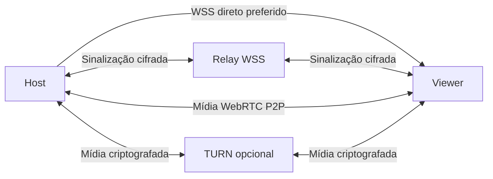

# Self Live

**Compartilhe sua tela e o áudio dos seus aplicativos em uma sala privada.**

Aplicativo desktop para Windows, feito com Electron e WebRTC. Crie uma sala,
envie o convite e compartilhe uma tela ou janela com vários espectadores.


[Como usar](docs/usage.md) · [Executável portátil](docs/pilot.md) ·
[Diagnóstico](docs/stream-audit.md) · [Documentação](docs/README.md)

> **Estado atual:** piloto fechado com mídia P2P. O relay facilita a entrada na
> sala, mas redes que exigem TURN ainda dependem de configuração adicional.
> A emissão de credenciais TURN pela VPS permanece pendente para distribuição.

## A interface

| Entrada | Sala |
| --- | --- |
|  |  |
| **Compartilhando** | **Assistindo** |
|  |  |

Capturas feitas com mídia sintética em instâncias Electron de teste.
O player oferece painéis retráteis, modo teatro, tela cheia e controles de áudio.

## O que está disponível

- Salas com senha, convites e presença em tempo real.
- Vários espectadores por transmissão e troca de stream.
- Seleção de tela/janela com prévias, qualidade e preferências salvas.
- Resoluções de 144p até Full HD; 15, 30 ou 60 fps no compartilhamento.
- Áudio por aplicativo, sem captura do microfone.
- Sinalização direta com fallback automático para relay WSS cifrado.
- IPv6, descoberta de rede e mapeamento opcional PCP/NAT-PMP/UPnP.
- Diagnóstico de captura, GPU, encoder e rede, com adaptive e exportação.
- Bandeja do Windows e encerramento coordenado dos recursos.

**Resolução máxima absoluta: 1920 × 1080.** Fontes maiores são reduzidas,
preservando as proporções quando possível; fontes menores não são ampliadas.
FPS e qualidade efetivos dependem da fonte, do PC e da conexão.

## Começar

### Usar o portátil em dois PCs

O EXE é gerado localmente, não fica versionado neste repositório e não exige
Node.js instalado nos PCs convidados. Veja [o guia do piloto](docs/pilot.md).

1. Execute o mesmo EXE nos dois PCs e preencha **Seu nome** na primeira abertura.
2. No host, escolha **Criar uma sala**.
3. Em **Convide alguém**, use **Copiar link** e **Copiar senha**; envie-os separadamente.
4. No convidado, escolha **Tenho um convite**, cole o link e informe a senha.
5. No host, clique em **Quero transmitir**, escolha a fonte e confirme **Compartilhar**.
6. No convidado, clique em **Assistir**.

Fechar a janela mantém o app na bandeja. Use **Sair** no menu da bandeja para
encerrar o processo; sair da sala mantém o aplicativo aberto.

### Executar pelo código

Requisitos: Windows x64 e Node.js 22 LTS ou superior.
Para compilar o helper de áudio, são necessários MSVC/Visual Studio Build Tools
e Windows SDK, conforme [o guia de áudio](docs/application-audio.md).

```powershell
npm ci
npm run check
npm test
npm run build:audio
npm start
```

Para gerar o portátil:

```powershell
npm run dist:pilot
```

Saída: `dist/Self-Live-0.1.0-x64.exe`. O comando compila o helper de áudio antes
do empacotamento. `npm run dist` mantém o alvo MSI.

## Áudio que acompanha o compartilhamento

| Fonte | Comportamento padrão |
| --- | --- |
| Janela | Envia o som do aplicativo escolhido, incluindo suas outras janelas/processos filhos. |
| Tela inteira | Envia os aplicativos de áudio disponíveis, excluindo Discord por padrão. |
| Sem áudio | Compartilha somente vídeo. |

Em **Mais opções**, ajuste áudio, bitrate e aplicativos excluídos. Outras chamadas
precisam ser excluídas por você. Escolher a janela do Discord compartilha seu áudio;
as exclusões de tela inteira não se aplicam à captura de uma janela.

O filtro atua por aplicativo, não por aba ou voz, e não silencia seus fones.
O áudio isolado exige **Windows build 20348+**; Windows 10 comum build 19045 não
oferece essa API. Em sistemas incompatíveis, o vídeo continua sem áudio.
Veja [requisitos e limites](docs/application-audio.md).

## Como a conexão funciona



**Sinalização:** o host mantém o WSS local e registra a sala no relay
`wss://relay.murilod.dev:8443`. Os convites tentam IPv6, IPv4 direto, relay e LAN,
com cinco segundos por endpoint, incluindo handshake. O relay público usa
certificado CA válido e não exige fingerprint. Relay indisponível não bloqueia
conexões diretas.

**Mídia:** H.264/Opus via WebRTC. TURN é um caminho separado para redes que não
permitem P2P. O relay WSS nunca transporta mídia. Conexões existentes podem
continuar durante uma queda breve de sinalização.

O piloto não inclui o segredo mestre TURN. Não o coloque no executável.
Consulte [a arquitetura de rede](docs/networking.md),
[o relay](docs/relay-setup.md) e [o Coturn](docs/turn-setup.md).

## Diagnóstico e GPU saturada

Jogos que ocupam a engine 3D podem reduzir a entrega de frames da captura,
mesmo com CPU e encoder pouco ocupados. Esse continua sendo o principal problema
de desempenho conhecido; o adaptive não garante eliminar engasgos.

Na entrada, **CONFIGURAÇÕES DE DIAGNÓSTICO** permite ativar logs, desativados por
padrão. Os JSONL ficam em **Documentos/SelfLive-Logs**, com rotação de 10 MiB e
retenção de cinco partes. Pare a transmissão para alterar a preferência.

O adaptive vem ligado e pode ocultar o preview, reduzir FPS/resolução e recuperar
qualidade quando a carga alivia. Com logs OFF, ele ainda mede o mínimo necessário,
sem gravar arquivos. Nos controles avançados, desligue-o para comparar ajustes
manuais. Limitar o FPS **do jogo** é diferente de limitar o FPS da captura.

[Procedimento de auditoria, resultados e limites das métricas →](docs/stream-audit.md)

## Privacidade

- A senha não acompanha o convite; o perfil local a protege com `safeStorage` do Electron.
- O convite contém endereços e identificadores de conexão; base64url não é criptografia.
- O relay recebe hash de autenticação e metadados, mas não recebe senha em texto puro,
  nome de sala em texto puro, SDP/ICE decifrados ou mídia.
- Hash e token determinísticos permitem tentativas de adivinhação offline;
  use senhas longas e aleatórias e compartilhe convites por canal privado.
- A mídia usa a proteção do WebRTC; TURN retransmite pacotes criptografados.
- Consulta de rede e relays observam metadados/IPs. O app não oferece anonimato.

## Desenvolvimento

| Comando | Validação |
| --- | --- |
| `npm run check` / `npm test` | Sintaxe e testes automatizados. |
| `npm run test:ui` / `npm run test:pilot` | Dashboard, preferências e configuração do piloto. |
| `npm run test:p2p` / `npm run test:room` | Mídia H.264/Opus e salas com múltiplos peers. |
| `npm run test:relay` / `npm run test:fallback` | Relay local, fallback e recuperação da sinalização. |
| `npm run test:adaptive` / `npm run test:logging-toggle` / `npm run test:resolution-cap` | Adaptive, logs e limite FHD. |
| `npm run test:audio` / `npm run test:turn` / `npm run test:upnp` | Componentes nativos e conectividade; dependem do ambiente. |

Os testes locais usam mídia sintética quando aplicável. Integrações TURN/UPnP
podem ficar em `skip`; não substituem validação em dois PCs e redes diferentes.
Veja [instruções detalhadas](docs/development.md).

## Limites atuais

- Captura continua no Chromium; sem OBS ou pipeline próprio DXGI/NVENC/AMF.
- O experimento de captura por CPU é indisponível nesse pipeline.
- Encoder por hardware depende do Chromium/driver; não há garantia de um SDK específico.
- Entrada via relay não garante mídia em redes que exigem TURN.
- Sem migração do host, associação do protocolo no Windows ou atualização automática.
- O portátil não tem certificado de assinatura de código configurado.
- Latência, fluidez sob carga e consumo de recursos precisam ser medidos no ambiente real.
- Integrações nativas, dependências e distribuição precisam de revisão antes de uma entrega pública.

Detalhes operacionais e procedimentos de teste estão no [índice da documentação](docs/README.md).
